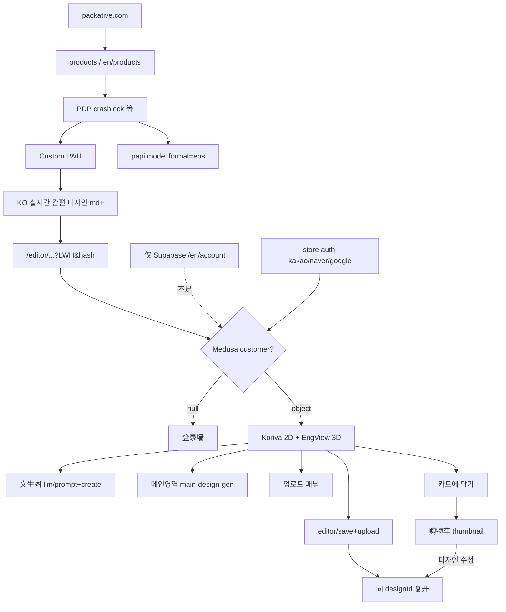

# 02 — 完整交互流程与截图证据

## 1. 公开用户旅程（已验证，含 store 登录后路径）

## 2. 逐步记录（摘要）

### 导航 / 认证

| ID | 结论 | 证据 |
|----|------|------|
| TC-NAV-01 Studio 营销 | Passed（非编辑器） | `/en/studio` |
| TC-AUTH-01 Supabase Google | Passed（账户）；store customer 需另轨 | `TC-AUTH-01` 已更新 |
| TC-NAV Mockup | KO `/mockup-studio` 登录墙；EN 404 | phase0 + 本轮复核 |

### 刀版

| ID | 结论 | 证据 |
|----|------|------|
| TC-DL-01 Custom 尺寸 | Passed | phase2-productbox-custom |
| TC-DL-02 Generating | Passed（UI+EPS 内容） | TC-DL-03 / crashlock EPS |
| TC-DL-03 EN model EPS | Passed；多盒型/大尺寸已差分 | `dieline-*.eps`；`phase3-gapfill-*` |

### Studio

| ID | 结论 | 证据 |
|----|------|------|
| TC-STUDIO-02 入口 | Passed（入口+登录后画布） | editor URL；phase1/3 |
| TC-AI-01 文生图 | Passed | phase1-studio-ai-apis |
| TC-AI-03 메인 영역 / 重生成 | Passed（独立缩略图再生成入口 Not Found） | `phase3-ai-main-area.*`；`TC-AI-03` |
| TC-AI-04 后处理 | Passed（去背/矢量化/编辑）；crop Partial；upscale Not Found | `phase3-ai-postprocess.*` |
| TC-STUDIO-03 贴图/3D/保存/车 | Passed | phase3-*；UV 加深见 06 |
| TC-STUDIO-04 保存复开 | Passed | `phase3-save-reopen.*` |
| TC-STUDIO-05 文本/元素/色 save | Passed（text/elements）；色 Partial | `phase3-text-elements-color-save.*` |
| TC-STUDIO-06 多盒型 editor | Passed（mailer+pillow）；sleeve Partial | `phase3-multibox-studio.*` |
| TC-AI-02 上传贴板 | Passed（API+Konva）；原生 picker Partial | `TC-AI-02` |
| 印前 Export E2E | Blocked/Partial — KO 编辑器无 Export 钮；白标可关功能 | packative.one 文案 + bundle |

## 3. 登录后完整链路（2026-11-10）

1. KO 社交登录 → `_medusa_jwt` → `/api/customer` 非空  
2. `/editor/...&designId=` → AI 生成（文生图或 메인 영역）→ 贴 2D → 3D Collada → 저장 → 카트  
3. 购物车：设计预览 + 尺寸/数量/价；「디자인 수정」或硬导航同 `designId` **复开贴图仍在**；**无** PDF 直链  

## 4. 操作状态与错误

| 状态 | 观察 |
|------|------|
| Add to cart disabled | 数量未选（已验证） |
| Dieline disabled | Custom 尺寸为 0（已验证） |
| Studio radio | `hidden md:flex`（窄屏隐藏） |
| 仅 Supabase | editor 登录墙 |
| Cookie 横幅 | CookieYes 拦截点击 |
| CDN SVG 未缓存 | 部分尺寸 403；EPS 仍可用 |
