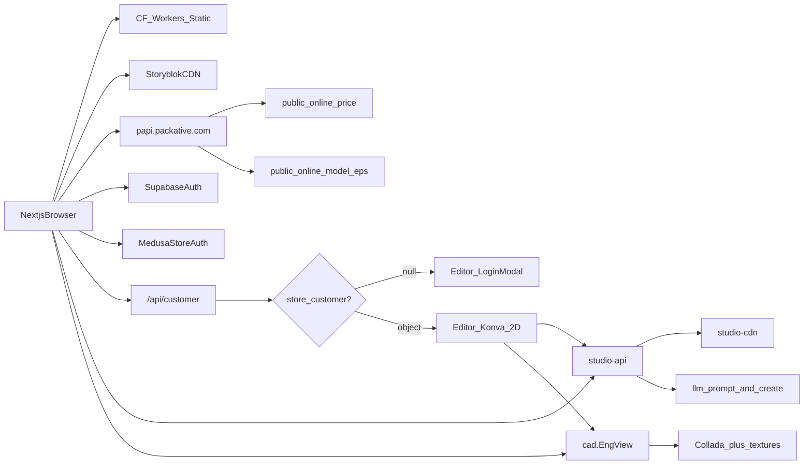

# 03 — API 与数据流分析

## 1. 方法与限制

- REA `capture_browser_scenario` 保留网络元数据；请求体默认不完全保留。
- 敏感 token/完整响应体不入库。
- 登录后已采集编辑器 AI / 保存 / dieline / CAD；敏感 token 与客户 PII **不入库**。

## 2. 已验证主机与端点

| 方法 | URL / 模式 | 场景 | 置信度 |
|------|------------|------|--------|
| GET | `packative.com/_next/static/chunks/*` | 静态资源 | 已验证 |
| GET | `packative-global-production.dominik-99e.workers.dev/_next/static/chunks/*` | Workers CDN | 已验证 |
| GET | `packative.com/_next/image?url=...` | 图片优化 | 已验证 |
| GET | `a.storyblok.com/f/...` | CMS 媒体 | 已验证 |
| GET | `assets.packative.com/...` | 品牌/产品图 | 已验证 |
| POST | `https://papi.packative.com/public/online/price` | 产品页计价 | 已验证（路径+201）；请求字段结构：**无法确认**（未完整保留 body） |
| GET | `https://papi.packative.com/public/online/model?productCode=&length=&width=&height=&format=eps` | 刀版 EPS；多盒型 | **已验证**；非 eps 多为 ~2KB stub |
| POST | `studio-api.packative.com/v1/llm/prompt` | AI prompt 改写 | 已验证 |
| POST | `studio-api.packative.com/v1/editor/create` | AI 生图 | 已验证 → CDN webp |
| POST | `studio-api.../v1/editor/main-design-gen` | 메인 영역生图（dieline+masks） | 已验证 → `print/image_0.png` |
| POST | `studio-api.../v1/editor/image-tools/bg-remove` | 去背 | 已验证 → png |
| POST | `studio-api.../v1/editor/image-tools/vectorize` | 矢量化 | 已验证 → svg |
| POST | `studio-api.../v1/editor/edit` | 局部编辑（FormData: prompt, reference_image_url, …） | 已验证 |
| POST/GET | `studio-api.../v1/editor/edit/history` | 编辑版本链 | 已验证 |
| GET | `studio-api.packative.com/v1/editor/generated-images?designId=` | 生成图列表 | 已验证 |
| GET | `studio-api.../v1/editor/dieline?product&length&width&height` | 刀版+蒙版元数据；头 `X-Tenant-Key`+`X-Tenant-User-Id` | **已验证** |
| POST | `studio-api.../v1/editor/dieline/overlay` | 叠印/蒙版合成 | 部分验证（公开 key 缺 Origin→403） |
| POST | `studio-api.packative.com/v1/editor/upload` | 画布层上传 PNG | 已验证 |
| POST | `studio-api.packative.com/v1/editor/save` | 设计保存；`canvas_data` v1.1 含 `konvaTexts`/`konvaImages`/`konvaElements`/`backgroundColor` | 已验证 |
| GET | `studio-cdn.../dielines/{type}/{L_W_H}/*` | `dieline.svg/png`、`area/main/total_mask.png` | 已验证 |
| GET | `studio-cdn.../save-points/{cus}/{designId}/thumbnail.png` | 购物车缩略图 | 已验证 |
| * | `cad.packative.com/resize-service/api/v1/resize/*` | EngView 模板缩放 | 已验证 |
| GET | `cad.packative.com/resource-service/api/v1/resource/{session}/{id\|TextureResourceN.png}` | Collada + 纹理（可 307→hash） | 已验证 |
| GET | `packative.com/api/customer` | Medusa store 客户 | 已验证（社交登录后有对象） |
| GET | `packative.com/editor/{productType}/{productId}?…&designId` | 在线编辑器 | 已验证 |
| OAuth | Supabase Google + `store.packative.com/store/auth/{kakao\|naver\|google}` | 双轨认证 | 已验证 |
| Analytics | GA / PostHog | 分析 | 已验证 |

## 3. 推断数据流

## 4. 上传 / AI / 导出

| 流程 | 公开文案 | 本会话实测 |
|------|----------|------------|
| 图片/Logo 上传 | 支持 | 编辑器「업로드」入口已见；未专项测上传体 |
| AI 生图 | 异步 | `llm/prompt`→`editor/create`→CDN webp **已验证** |
| 设计保存 / 加购 | 可保存下单 | `save`/`upload` + 购物车预览 **已验证** |
| 印前导出 | 邮件 / DPI / CMYK 宣传 | bundle：export/vectorize/upscale 邮件文案；购物车无 PDF 直链；**未跑通收件** |
| 刀版下载 | Generating | `format=eps` 多盒型成功；其它 format≈2KB stub |
| 编辑器路由 | — | `length/width/height/quantity/coating/hash/designId/itemId` |
| EN Studio | Packative Studio | `/en/studio` 营销+Demo；PDP 无 Easy Design |

## 5. 错误处理

- 产品页 Add to cart：缺数量时 disabled（已验证）
- 无效韩文 URL：404 页（已验证）
- API 错误码契约：无法确认

## 6. 对独立实现的建议（非对方源码）

PackFlow 应对齐能力而非对方路径：

- `POST /api/v1/designs/` 创建设计（team 隔离）
- `POST /api/v1/designs/{id}/ai-jobs/` + Celery 轮询 `GET .../ai-jobs/{job_id}/`
- `POST /api/v1/designs/{id}/exports/` 异步导出
- 几何可优先浏览器侧 TypeScript 引擎；服务端仅做校验与归档

字段命名遵循项目 camelCase(TS) / snake_case(Python) 映射约定。
