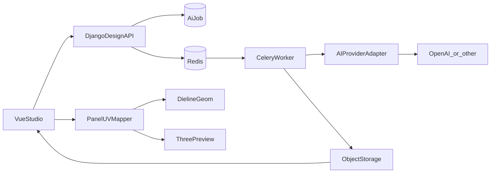

# 04 — AI 包装设计模块研究

## 1. 观察结论摘要

| 能力 | 状态 |
|------|------|
| 营销/博客描述的 AI 文生图、风格、局部修改、引用图 | 文生图/风格 **已验证**；局部修改等部分仍待测 |
| KO PDP「실시간 간편 디자인」→ `/editor` | **已验证**（需 store customer） |
| AI 编辑器文生图（이미지 생성） | **Passed**：`/v1/llm/prompt` → `/v1/editor/create` → CDN webp；`tool:image` |
| AI 메인 영역 디자인 | **Passed**：`designTheme` → `/v1/editor/main-design-gen`（dieline+total/area mask）→ `print/image_0.png`；`tool:design` |
| AI 后处理 | **Passed**：`/v1/editor/image-tools/bg-remove`、`/vectorize`、`/v1/editor/edit` + `edit/history`；crop 本地无 API；KO gallery **无** upscale |
| 缩略图本地「재생성」入口 | **Not Found**；改 prompt 再点「생성」可再跑一轮（已验证） |
| 独立实现方案 | 下文给出，不声称获得对方算法 |

### 入口与生成取证（已验证）

- 门禁：`_medusa_jwt` + `/api/customer` 非空（`store.packative.com/store/auth/*`）。
- 编辑器工具：AI / 배경 / 업로드 / 텍스트 / 요소 / 레이어；AI 下拉至少 **이미지 생성** / **메인 영역 디자인**。
- **이미지 생성**：`POST /v1/llm/prompt` → `POST /v1/editor/create` → CDN `{tenant}/generated-images/{customerId}/{designId}/{uuid}/image.webp`。证据：`phase1-studio-ai-apis.txt`。
- **메인 영역 디자인**：UI 显示主印刷面高亮；`POST /v1/llm/prompt`（body 仅 `designTheme`）→ `POST /v1/editor/main-design-gen`（`prompt, main_pixel, dieline_url, total_mask_url, area_mask_url, user_id, uuid, design_id`）→ CDN `.../{uuid}/print/image_0.png` → `POST /v1/editor/work-history`（`tool:"design"`）。证据：`phase3-ai-main-area.txt`、`TC-AI-03`。
- 后续链路已验证：缩略图点击 → 贴 2D（메인 영역为全刀版 ~2048×1216）→ `/v1/editor/upload`+`/save` → 购物车；**同 designId 复开仍还原**（`TC-STUDIO-04`）。
- **后处理**（`TC-AI-04` / `phase3-ai-postprocess.txt`）：gallery 动作 편집-credits / 배경 제거-credits / 벡터화-credits / 자르기；版本链 v1→v2→v3；`tool` 分别为 `edit` / `image_remove_bg` / `image_vectorize`。
- **多盒型**：mailerbox 上 `main-design-gen` 同构，仅 CDN slug 换为 `dielines/mailerbox/{L}_{W}_{H}/`（`TC-STUDIO-06`）。

## 2. 宣传能力清单（来源：packative.one/studio、官方博客）

以下均为**待验证假设**，除非另行标注：

1. 文字 prompt 生成包装图案，贴合主印刷面板（非简单裁切）
2. 风格预设 + 参考图强度
3. 引号内品牌文字保真（多语言）
4. 局部 regenerate / 笔刷修复
5. 背景去除、放大、矢量化
6. 图层、文本样式、字体、形状、历史
7. Logo/图片上传并在刀版上摆放
8. 应用到 2D 展开图与 3D 折叠预览

FAQ 另提及 OCR、segmentation、diffusion、upscaling 等模型类型名词 → **无法确认**具体供应商。

## 3. 推荐独立实现架构



### 3.1 AI Provider 适配层

```ts
interface AiGenerateRequest {
  prompt: string
  stylePresetId?: string
  referenceImageIds?: string[]
  panelMask?: { widthMm: number; heightMm: number; contourSvgPath: string }
  seed?: number
  locale?: string
}

interface AiGenerateResult {
  imageAssetId: string
  widthPx: number
  heightPx: number
  provider: string
  model: string
}
```

- 实现 `AiProviderAdapter.generate / inpaint / upscale / removeBackground`
- 配置切换供应商；禁止把某一供应商写死进业务层

### 3.2 异步任务

复用现有 Celery Worker（`deploy/compose.yml` 已有 `worker`）：

- 状态：`queued | running | succeeded | failed`
- 前端短轮询或 SSE（二期）
- 额度：按 team 计费/配额表

### 3.3 图案 → 刀版 / UV

1. 几何引擎输出每个 `Panel` 的外轮廓与可印区域（safe/bleed）
2. AI 图仅渲染到 `printFace` 面板（或用户选中面板）
3. 2D：SVG/Canvas 图层把图像 clip 到面板 path
4. 3D：同一图像作为对应 face 的 texture map；折叠动画不改图层数据

### 3.4 2D 编辑引擎选型（独立决策）

| 候选 | 评价 |
|------|------|
| **保留 SVG + 轻量交互层（推荐默认）** | 与现有 `integrations/dieline` SVG 刀版叠加成本最低 |
| Konva.js | 适合复杂图层变换；需新建叠加管线 |
| Fabric.js | 同上 |
| 纯 Canvas2D | 灵活但工程量大 |

**本期建议**：先 SVG 刀版 + 面板贴图图层；若图层交互复杂度上升再引入 Konva。

## 4. 测试计划（登录后执行）

见 [test-cases/TC-AI-*.md](test-cases/)。自有文案与自有 Logo，禁止使用对方品牌素材。
