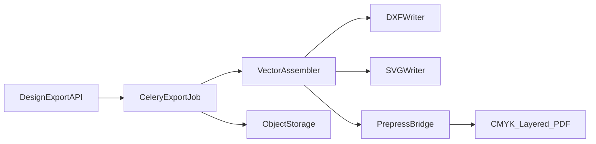

# 07 — 生产文件导出研究

## 1. 目标站：宣传 vs 实测

| 能力 | 宣传来源 | 本会话实测 | 标记 |
|------|----------|------------|------|
| 分层 PDF（刀版独立层） | packative.one | 未下载打开成品 | 未验证 |
| 真 CMYK + soft proof | packative.one | 未验证 | 未验证 |
| 300 / 600 DPI | packative.one | 前端 i18n：`Processing ${dpi??300} DPI Export`；300≈15s，其它≈30s | **部分验证**（文案/状态机，未见请求落地） |
| 14 ICC | packative.one | 未验证 | 未验证 |
| 长导出后台邮件 | packative.one | 文案：print-ready/vectorize 邮件；bundle 有状态机；**KO B2C 编辑器无 Export 入口** | **部分验证 / Blocked（租户）** |
| 功能开关 | packative.one | 「Turn export, 600 DPI, AI, vectorizing, upscaling and 3D on or off for each storefront」 | **已验证文案**（解释为何本账号无 Export） |
| 刀版文件下载 | 产品页 Dieline | `format=eps` 多盒型可用；`format=pdf|svg|dxf|ai|png|jpg` → ~2.1KB PDF stub | **已验证 EPS**；非 eps **不可用** |
| 编辑器刀版 SVG/蒙版 | CDN + dieline API | SVG Cutting/Creasing；masks PNG 全套 | **已验证** |
| 编辑器场景保存 | `/v1/editor/save` + `/upload` | canvas 2048×1216；`base-layer.png`；`scene_svg_url` | 已验证路径；印前 PDF **未直接下载** |
| 购物车导出 | — | 仅「디자인 수정」+ `save-points/.../thumbnail.png`；**无** PDF/AI 下载链 | 已验证缺失直链 |
| Design Guide | 产品页按钮 | 可见 | 已验证存在 |
| Illustrator 回传 | 文案要求 AI 文件 | 上传控件文案可见 | 已验证文案 |

**不得**因宣传文案认定所有账号均支持全部导出选项。  
**本轮结论**：印前导出在产品线存在（白标可开关 + 前端状态机），但 **packative.com KO 订单编辑器未暴露 Export**；E2E 邮件附件 / CMYK 分层 PDF **未取得**。用例：`test-cases/TC-EXPORT-01-print-ready.md`。

## 2. PackFlow 现有导出（代码已验证）

[`exportDieline.js`](../../global-toolbox-vue3/src/integrations/dieline/exportDieline.js)：

- DXF R12：图层 TRIM / CREASE / BLEED，mm
- SVG 分层 + 尺寸标注
- PDF（pdf-lib，RGB/标准字体；CJK 限制）
- AI（PDF 兼容 .ai）
- 一律标注 `DEMO · NOT FOR DIE CUTTING` / `manufacturingReady=false`

## 3. 生产级独立要求与替代技术

| 要求 | 方案 |
|------|------|
| 真实物理尺寸 mm | 矢量路径以 mm 为用户单位；PDF 用 UserUnit/缩放约定并文档化 |
| 刀线/折线分层 | DXF 图层；PDF Optional Content Groups（OCG） |
| 出血/安全线 | 独立 layer；校验报告 |
| CMYK | **禁止**用 RGB PDF 冒充。可选：① 服务端 Ghostscript/一伙伴印前服务转 CMYK；② 导出标注「RGB 预览稿」；③ 商业 PDF 库/外部 RIP |
| 分层 PDF | pdf-lib 对 OCG/CMYK 支持有限 → 复杂印前走 **Worker + 专用工具链** |
| 字体 | 嵌入子集或转曲；CJK 必须嵌入 |
| 图像 DPI | 导出前检查有效 PPI；低于阈值阻断或警告 |
| 一致性 | 同一 `DielineOutput` + `artwork` 哈希写入导出元数据 |

## 4. 建议 PackFlow 导出服务

阶段 1：升级现有前端 DXF/SVG，去掉 DEMO 门禁仅当 `validation.ok && manufacturingChecks.pass`。  
阶段 2：Worker 印前 PDF。  
阶段 3：ICC 配置文件可选。
