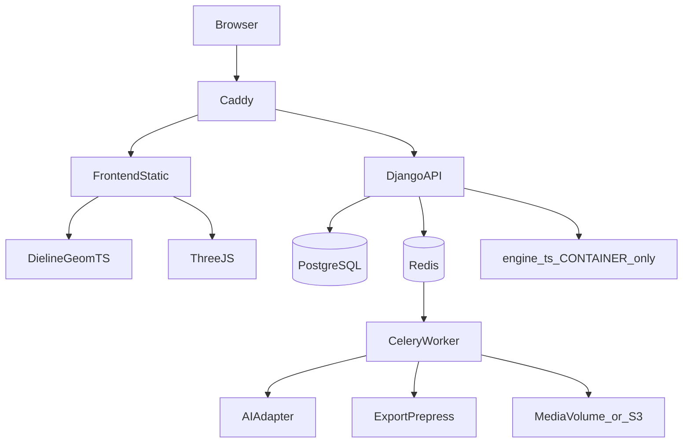

# 09 — 完整系统架构与数据库设计

## 1. 原则

- 沿用 Vue3 + Django DRF + PostgreSQL + Compose/Caddy
- 几何计算前端 TypeScript 模块独立；服务端校验与归档
- AI / 印前导出可插拔
- **不破坏**装柜、卡板、报告、文件导入现有链路
- Team 隔离：所有设计对象带 `team_id`，服务端强制校验

## 2. 运行时架构

Worker 复用现有 `worker` 服务；若印前依赖过重，再拆 `worker_prepress`（非必须首期）。

## 3. 数据库设计（新增 `designs`）

沿用 `schemes` 的不可变修订思路。

### 3.1 表

**Design**

| 字段 | 类型 | 说明 |
|------|------|------|
| id | string PK | `dsn_...` |
| team_id | FK | 租户 |
| name | varchar | |
| box_type | varchar | |
| locale | varchar | |
| row_version | int | 乐观锁 |
| current_revision_id | FK null | |
| deleted_at | timestamptz null | 软删 |
| created_at / updated_at | timestamptz | |

**DesignRevision**

| 字段 | 类型 | 说明 |
|------|------|------|
| id | uuid PK | |
| design_id | FK | |
| revision_no | int | unique(design, rev) |
| schema_version | int | |
| params_json | jsonb | DielineInput |
| knife_json | jsonb | 可选缓存 |
| artwork_json | jsonb | 图层 |
| content_hash | char64 | |
| creator_id | FK null | |
| created_at | timestamptz | |

**DesignAsset**

| 字段 | 类型 | 说明 |
|------|------|------|
| id | uuid | |
| team_id | FK | |
| design_id | FK null | |
| purpose | enum | logo/reference/ai_output/export |
| file_asset_id | FK | 复用 `files.FileAsset` |
| meta_json | jsonb | 宽高 DPI 等 |

**AiJob**

| 字段 | 类型 | 说明 |
|------|------|------|
| id | uuid | |
| team_id / design_id | FK | |
| status | enum | |
| request_json / result_json | jsonb | |
| provider / model | varchar | |
| error_message | text | |
| celery_task_id | varchar | |

**ExportJob**

| 字段 | 类型 | 说明 |
|------|------|------|
| id | uuid | |
| team_id / design_id / revision_id | FK | |
| format | enum | dxf/svg/pdf/png |
| options_json | jsonb | dpi/icc/layers |
| status | enum | |
| output_file_id | FK null | |
| error_message | text | |

### 3.2 迁移与回滚

1. 新增 app `designs` + 初始迁移
2. 回滚：`migrate designs zero`（空库可）；有数据时先导出备份再删表
3. 不修改 `schemes` / `calculations` 表结构

## 4. API 草图（资源化）

- `GET/POST /api/v1/designs/`
- `GET/PATCH /api/v1/designs/{id}/`
- `POST /api/v1/designs/{id}/revisions/`
- `POST /api/v1/designs/{id}/ai-jobs/`
- `GET /api/v1/ai-jobs/{id}/`
- `POST /api/v1/designs/{id}/exports/`
- `GET /api/v1/exports/{id}/`

成功/错误包遵循项目 `references/common.md` 约定；下载类可用 302/流式，不强套 JSON。

## 5. 前端模块

- 路由：包装设计 Studio（与现有 dieline lab 可并存，逐步合并）
- 状态：design document store
- 请求：统一走现有 API client
- i18n：补齐 ko/zh/en key
